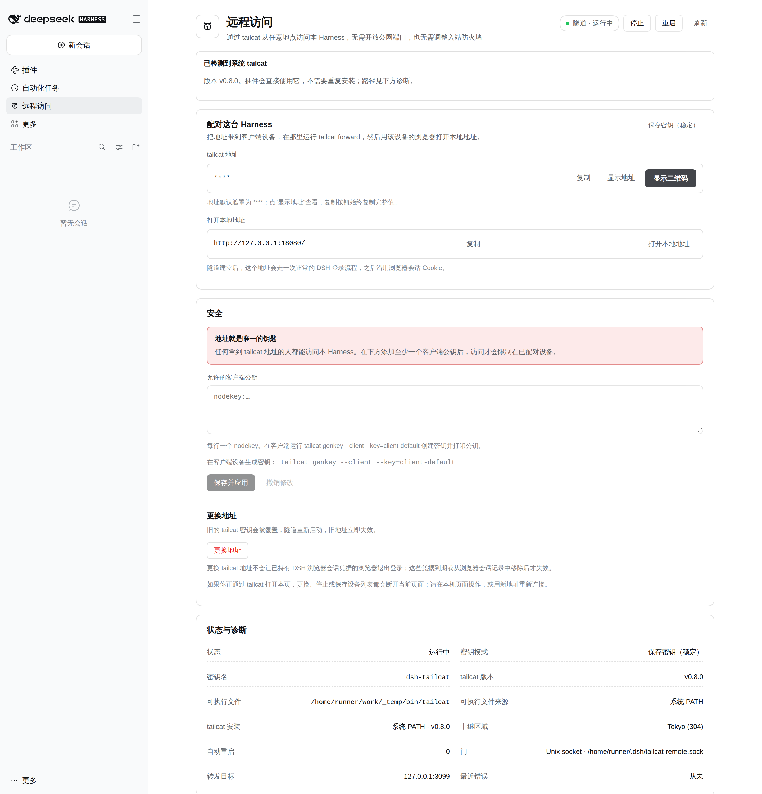
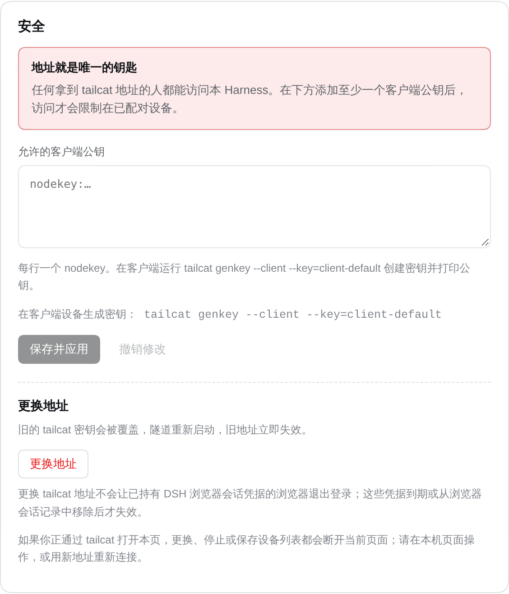
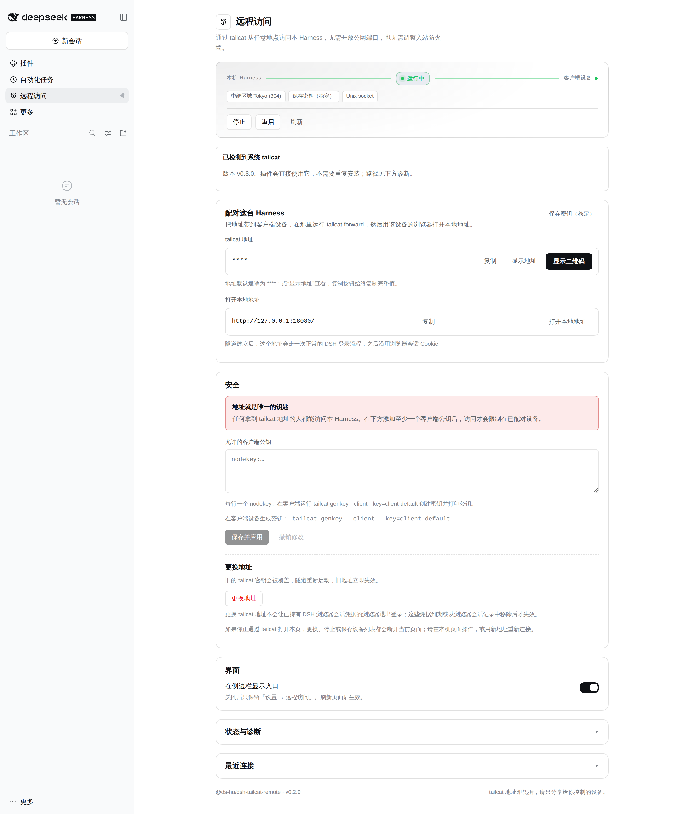
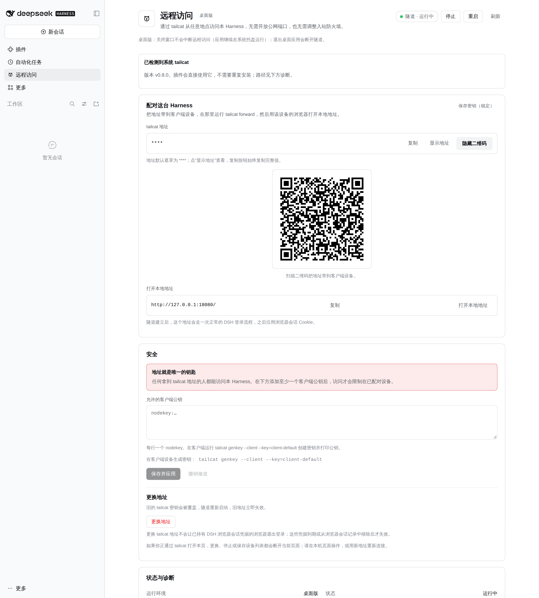
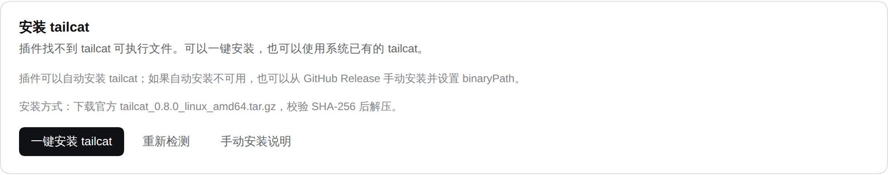

<p align="center">
  
</p>

<h1 align="center">Remote Access</h1>

<p align="center">
  <strong>Reach DeepSeek Harness from any network through tailcat — no public port, no inbound firewall change.</strong>
</p>

<p align="center">
  <a href="https://www.npmjs.com/package/@ds-hu/dsh-tailcat-remote"></a>
  <a href="https://github.com/ds-hu/dsh-tailcat-remote/actions/workflows/ci.yml"></a>
  <a href="https://github.com/ds-hu/dsh-tailcat-remote/actions/workflows/desktop-profile.yml"></a>
  <a href="LICENSE"></a>
  <a href="README.md">中文</a>
</p>

---

## What it is

DeepSeek Harness listens on the local machine by default. Opening the same GUI from a laptop, phone, or another computer usually means a public port, port forwarding, or a reverse proxy.

Remote Access folds that into one plugin. The Host supervises a `tailcat` process and a tailnet-only local door. The client needs a tailcat address and one command. The same package serves the **web profile** of `dsh web` and the **desktop profile** of the Electron application.

<p align="center">
  
</p>

## What you get

- **One address across networks.** No public port. tailcat uses a DERP relay or a direct path, and the browser finally talks to the client's own `127.0.0.1`.
- **Scan or copy to pair.** The address is masked as `****` until you choose **Show address**; Copy always copies the full value, and the QR code is opt-in.
- **The pairing page stays compact.** It shows the address, QR code, and local URL only; the client command and step list are no longer rendered. See **Use** below for the command example.
- **A key allow-list.** The address is the only credential by default. Add client public keys and unauthorized devices are refused during the tailcat handshake.
- **Rotate the address, manage the process.** Start, stop, restart, and rotate in **Settings → Remote Access**; inspect the relay region, recent connections, refusals, and errors.
- **The sidebar row is optional.** A shortcut row sits in the sidebar panel list by default and opens the same page. The page's **Interface** card switches it off; the Settings entry always stays, and a reload applies the change.
- **Log in once.** The first remote visit runs the normal DSH login flow and then keeps an HttpOnly cookie. The token never appears in the remote URL.
- **The same page locally and remotely.** The panel works through DSH's owner API, so both views behave alike.

<p align="center">
  
</p>

Opened from its sidebar row, the same page gets the whole canvas and the diagnostics grid widens to two columns:

<p align="center">
  
</p>

## Install

Add the plugin to the web profile:

```sh
dsh plugin --profile web add @ds-hu/dsh-tailcat-remote
```

List the package in the profile's `dsh.profile.bundles`, then restart `dsh web`:

```json
{
  "dsh": {
    "profile": {
      "bundles": ["…", "@ds-hu/dsh-tailcat-remote"]
    }
  }
}
```

Installing the bundle from **Plugin Manager** has the same effect.

### The desktop application

The desktop application runs a profile named `desktop` (`$DSH_HOME/profiles/desktop`) composed from the same Web bundles. Its Host listens on an OS-assigned **random port** on `127.0.0.1`; the plugin reads that port at runtime, so **no port configuration is needed**.

1. Open the desktop application once so it initializes the `desktop` profile, then **quit it completely** (on Windows, quit from the tray icon).
2. Install the plugin into the desktop profile, one of:
   - **Recommended:** install `@ds-hu/dsh-tailcat-remote` by package name from the application's **Plugin Manager**. The application runs pnpm, records the package in `dsh.profile.bundles`, and applies it after the restart it prompts for.
   - **Manual:** edit `%USERPROFILE%\.dsh\profiles\desktop\package.json` and add the package to both `dependencies` and `dsh.profile.bundles`:

     ```json
     {
       "dependencies": { "@ds-hu/dsh-tailcat-remote": "^0.2.1" },
       "dsh": {
         "profile": {
           "bundles": [
             "@deepseek-ai/dsh-base",
             "@deepseek-ai/dsh-web-app",
             "@ds-hu/dsh-tailcat-remote"
           ]
         }
       }
     }
     ```

     Then run `pnpm install` inside `%USERPROFILE%\.dsh\profiles\desktop` and start the application again.

     An npm-installed `dsh` refuses `--profile desktop`. The command the desktop application can install accepts that profile, but it only runs pnpm: it does **not** add the package to `dsh.profile.bundles`, so the manual path has to add that entry itself.
3. Open **Settings → Remote Access**, install tailcat and show the address as below, then run `tailcat forward` on the client.

<p align="center">
  
</p>

**Desktop notes**

- **Closing the window is not quitting.** On Windows the application keeps running in the system tray, so remote access stays up. Quitting from the tray ends the Host and the tunnel.
- **The address survives upgrades.** A desktop update restarts the Host and briefly interrupts the tunnel; the saved tailcat key does not change, so the same address reconnects.
- **A remote visitor gets the ordinary Web GUI.** Desktop-only surfaces (the Browser sidebar tabs, native file dialogs, platform sign-in) exist only inside the desktop window.
- **This is not multi-user isolation.** The desktop window and every remote browser share one Host, one credential store, and one agent session. Share the address only with people you trust.

### tailcat installation is managed

Restart `dsh web` and open **Settings → Remote Access**. If the Host has no tailcat, the page shows an install card:

- **Linux / Windows:** click **Install tailcat**. The plugin selects the official tailcat v0.8.0 asset for `process.arch`, downloads it, verifies its SHA-256 against the official `checksums.txt`, and extracts it to `$DSH_HOME/tailcat-remote/bin/`. The system `PATH` is not modified.
- **macOS:** if Homebrew is available, the same button updates Homebrew and installs/upgrades tailcat (0.8.0 or newer), then copies the executable into the managed directory. Intel Macs have no bottle, so Homebrew builds from source and can take several minutes. Without Homebrew, the page shows a clear message and a manual-install link.
- **Your own tailcat:** on startup the plugin checks `PATH` and common package locations (`/opt/homebrew/bin`, `/usr/local/bin`, `/usr/bin`, and so on). It uses an existing install directly and never downloads over it. The diagnostics section shows the executable's source and version.
- **Other platforms or architectures:** install tailcat manually (0.8.0 or newer) from [the upstream instructions](https://github.com/tailscale/tailcat#install), then point `binaryPath` at it. `binaryPath` takes precedence over the managed copy.

<p align="center">
  
</p>

The managed install only runs after you click the button: there is no background download and no per-platform binary payload in the npm package.

> Automatic installation covers the **Host-side** tailcat server only. The client device still needs its own tailcat to run `tailcat forward`; this plugin does not include a client program.

## Use

1. Restart Harness and open **Settings → Remote Access**.
2. If the page reports a missing tailcat, click **Install tailcat** first; otherwise wait for **Online** and the address (masked by default; choose **Show address** to reveal it). The first start creates a saved key and probes a DERP region, which can take a minute.
3. On the client device, install tailcat, copy the address from the page or scan the QR code, then run:

   ```sh
   tailcat forward tc… 18080:13080
   ```

4. Open `http://127.0.0.1:18080/` in the client browser. The first visit completes DSH login; later visits go straight in.
5. Before sharing the address, add at least one client public key in **Security**.

## Security

The tailcat address is a credential. In address-only mode, anyone who has it can reach the DSH login entry and receive a browser session bound to the remote authority.

- Pair the address with a key allow-list: run `tailcat genkey --client --key=client-default` on the client and add the printed public key on the page.
- Rotating the address invalidates the old one immediately. Browsers that already hold a DSH cookie are not signed out; use DSH's session management for that.
- Do not expose port 3080 directly. The plugin lets tailcat reach a single 0600 Unix-socket door and opens no public listener.
- If the Web listener uses HTTPS, the door refuses to start; this version does not replay cookies behind TLS.
- The desktop application adds no network exposure: its Host still listens on a random loopback port, and on Windows the door still binds only `127.0.0.1:13080`. It usually stays in the tray, though, so the tunnel is on by default; quitting from the tray removes that path.

The full threat model, limitations, and checklist are in [Security](docs/SECURITY.md).

## Docs

- [Technical notes](docs/TECHNICAL.md): door, supervisor, request path, lifecycle, failure modes.
- [Host ↔ panel contract](docs/CONTRACT.md): JSON API, state fields, error codes.
- [Security](docs/SECURITY.md): trust boundaries, credentials, rotation, limitations.
- [NOTICE](NOTICE): qrcode-generator and tailcat attribution.

## License

MIT — see [LICENSE](LICENSE) and [NOTICE](NOTICE).
