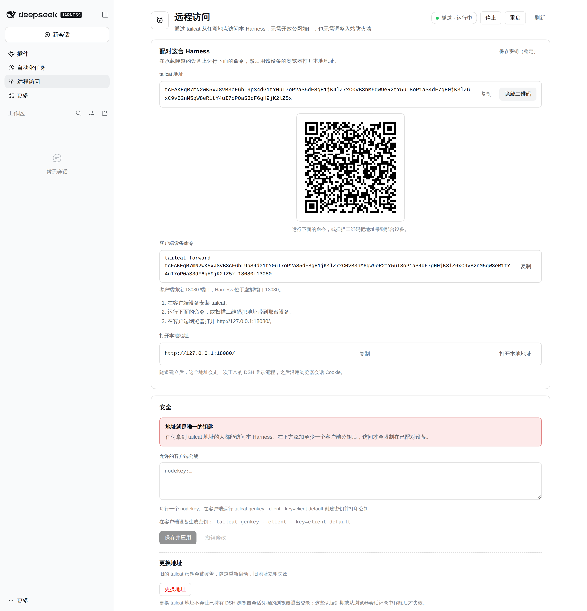
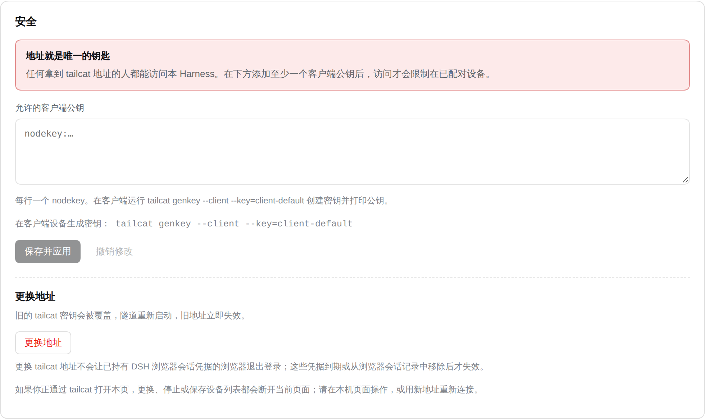

<p align="center">
  
</p>

<h1 align="center">远程访问 · Remote Access</h1>

<p align="center">
  <strong>用 tailcat 把 DeepSeek Harness 带到任何网络，不用开公网端口，不用改入站防火墙。</strong>
</p>

<p align="center">
  <a href="https://www.npmjs.com/package/@ds-hu/dsh-tailcat-remote"></a>
  <a href="https://github.com/ds-hu/dsh-tailcat-remote/actions/workflows/ci.yml"></a>
  <a href="LICENSE"></a>
  <a href="README.en.md">English</a>
</p>

---

## 它解决什么

DeepSeek Harness 默认只在本机监听。想从笔记本、手机或另一台电脑打开同一个界面，通常要公网端口、端口转发或一层反向代理。

远程访问把这件事收进一个插件：Host 负责托管 `tailcat` 进程和一条 tailnet-only 的本地门卫，客户端只需要 tailcat 地址和一行命令。

<p align="center">
  
</p>

## 能带来什么

- **一个地址，跨网络进入。** 不开公网端口，`tailcat` 走 DERP 中继或直连，浏览器最终访问客户端自己的 `127.0.0.1`。
- **扫码或复制即可配对。** 页面给出地址、二维码和完整的 `tailcat forward …` 命令，三步说明就写在旁边。
- **白名单限制谁能连。** 默认只有地址这一把钥匙；添加客户端公钥后，未授权设备在 tailcat 握手阶段就被拒绝。
- **地址可换，进程可管。** 侧边栏里启动、停止、重启、轮换地址，查看中继区域、最近连接、拒绝记录和错误信息。
- **登录仍然只有一次。** 第一次打开远程地址会走正常的 DSH 登录流程，之后浏览器沿用 HttpOnly cookie；token 不会出现在远程 URL 里。
- **本机与远程同一页。** 页面本身通过 DSH 的 owner API 工作，在本机操作和远程操作一致。

<p align="center">
  
</p>

## 安装

先安装 [tailcat](https://github.com/tailscale/tailcat#install)。它需要出现在 Host 的 `PATH` 里；也可以稍后在插件配置里写绝对路径 `binaryPath`。

```sh
# macOS、Linux、Windows、FreeBSD 等都有安装方式
# 例如静态二进制：
tailcat version
```

再把插件装进 web profile：

```sh
dsh plugin --profile web add @ds-hu/dsh-tailcat-remote
```

把包加进 profile 的 `dsh.profile.bundles`，然后重启 `dsh web`：

```json
{
  "dsh": {
    "profile": {
      "bundles": ["…", "@ds-hu/dsh-tailcat-remote"]
    }
  }
}
```

也可以在 **插件管理** 里安装这个 bundle，效果相同。

## 使用

1. 重启 Harness，侧边栏打开 **远程访问**。
2. 确认状态是 **运行中**，地址和二维码已经出现。首次启动要生成保存密钥并探测 DERP 区域，可能需要一分钟。
3. 在要访问的客户端设备上安装 tailcat，运行页面给出的命令，或者扫描二维码取得地址：

   ```sh
   tailcat forward tc… 18080:13080
   ```

4. 在客户端浏览器打开 `http://127.0.0.1:18080/`。第一次会完成 DSH 登录，之后直接进入。
5. 分享地址前，建议先在 **安全** 区添加至少一个客户端公钥。

## 安全

`tailcat` 地址就是一份凭据。没有白名单时，拿到地址的人就能到达 DSH 登录入口，并自动获得一个绑定了远程 authority 的浏览器会话。

- 给地址配白名单：客户端运行 `tailcat genkey --client --key=client-default`，把打印的公钥加进页面。
- 更换地址后，旧地址立即失效。已经拿到 DSH cookie 的浏览器不会自动退出，需要按 DSH 的会话管理单独处理。
- 不要直接暴露 3080。插件只让 tailcat 通过一条 0600 的 Unix socket 访问 door，不监听公网。
- 如果 Web listener 是 HTTPS，door 会拒绝启动；当前版本不支持在 TLS 后面重放 cookie。

完整威胁模型、限制和检查清单见 [安全说明](docs/SECURITY.md)。

## 文档

- [技术说明](docs/TECHNICAL.md)：door、supervisor、请求路径、生命周期、失败模式。
- [Host ↔ 面板契约](docs/CONTRACT.md)：JSON API、状态字段、错误码。
- [安全说明](docs/SECURITY.md)：信任边界、凭据、轮换、已知限制。
- [NOTICE](NOTICE)：qrcode-generator 与 tailcat 的第三方归属。

## 许可

MIT，见 [LICENSE](LICENSE) 与 [NOTICE](NOTICE)。
