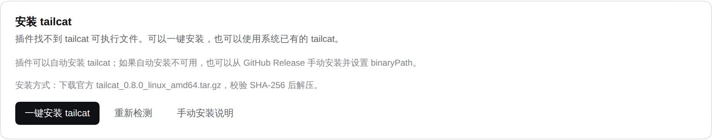

<p align="center">
  
</p>

<h1 align="center">远程访问 · Remote Access</h1>

<p align="center">
  <strong>用 tailcat 把 DeepSeek Harness 带到任何网络，不用开公网端口，不用改入站防火墙。</strong>
</p>

<p align="center">
  <a href="https://www.npmjs.com/package/@ds-hu/dsh-tailcat-remote"></a>
  <a href="https://github.com/ds-hu/dsh-tailcat-remote/actions/workflows/ci.yml"></a>
  <a href="https://github.com/ds-hu/dsh-tailcat-remote/actions/workflows/desktop-profile.yml"></a>
  <a href="LICENSE"></a>
  <a href="README.en.md">English</a>
</p>

---

## 它解决什么

DeepSeek Harness 默认只在本机监听。想从笔记本、手机或另一台电脑打开同一个界面，通常要公网端口、端口转发或一层反向代理。

远程访问把这件事收进一个插件：Host 负责托管 `tailcat` 进程和一条 tailnet-only 的本地门卫，客户端只需要 tailcat 地址和一行命令。同一份插件同时适用 `dsh web` 的 **web profile** 与桌面版（Electron）使用的 **desktop profile**。

<p align="center">
  
</p>

## 能带来什么

- **一个地址，跨网络进入。** 不开公网端口，`tailcat` 走 DERP 中继或直连，浏览器最终访问客户端自己的 `127.0.0.1`。
- **扫码或复制即可配对。** 地址默认遮罩为 `****`，点“显示地址”才展开；复制按钮始终复制完整值，二维码按需显示。
- **配对页保持精简。** 只保留地址、二维码和本地地址，不再渲染客户端命令与使用步骤；命令示例见下方“使用”。
- **白名单限制谁能连。** 默认只有地址这一把钥匙；添加客户端公钥后，未授权设备在 tailcat 握手阶段就被拒绝。
- **地址可换，进程可管。** 侧边栏里启动、停止、重启、轮换地址，查看中继区域、最近连接、拒绝记录和错误信息。
- **登录仍然只有一次。** 第一次打开远程地址会走正常的 DSH 登录流程，之后浏览器沿用 HttpOnly cookie；token 不会出现在远程 URL 里。
- **本机与远程同一页。** 页面本身通过 DSH 的 owner API 工作，在本机操作和远程操作一致。

<p align="center">
  
</p>

## 安装

把插件装进 web profile：

```sh
dsh plugin --profile web add @ds-hu/dsh-tailcat-remote
```

把包加进 profile 的 `dsh.profile.bundles`，然后重启 `dsh web`：

```json
{
  "dsh": {
    "profile": {
      "bundles": ["…", "@ds-hu/dsh-tailcat-remote"]
    }
  }
}
```

也可以在 **插件管理** 里安装这个 bundle，效果相同。

### 桌面版（Electron 桌面应用）

桌面版运行的是名为 `desktop` 的 profile（`$DSH_HOME/profiles/desktop`），内容就是 Web 应用的同一套 bundle。它只监听 `127.0.0.1` 上由系统分配的**随机端口**，插件在运行时读取这个端口，**不需要任何端口配置**。

1. 先打开一次桌面版，让它初始化 `desktop` profile，然后**完全退出**（Windows 上要从托盘图标退出）。
2. 把插件装进 desktop profile，任选一种：
   - **推荐**：在桌面版的 **插件管理** 里按包名安装 `@ds-hu/dsh-tailcat-remote`。应用会完成 pnpm 安装、把包写进 `dsh.profile.bundles`，并按提示重启生效。
   - **手动**：编辑 `%USERPROFILE%\.dsh\profiles\desktop\package.json`，在 `dependencies` 与 `dsh.profile.bundles` 里各加一项：

     ```json
     {
       "dependencies": { "@ds-hu/dsh-tailcat-remote": "^0.2.0" },
       "dsh": {
         "profile": {
           "bundles": [
             "@deepseek-ai/dsh-base",
             "@deepseek-ai/dsh-web-app",
             "@ds-hu/dsh-tailcat-remote"
           ]
         }
       }
     }
     ```

     然后在 `%USERPROFILE%\.dsh\profiles\desktop` 里运行 `pnpm install`，再打开桌面版。

     用 npm 全局安装的 `dsh` 会拒绝 `--profile desktop`；桌面版自带的 `dsh` 命令（如果在应用里安装过）允许这个 profile，但它只做 pnpm 安装，**不会**把包写进 `dsh.profile.bundles`，所以手动路径要自己补上这一项。
3. 侧边栏打开 **远程访问**，按下面的步骤安装 tailcat、出示地址；客户端 `tailcat forward` 后即可访问。

**桌面版使用须知**

- **关闭窗口不等于退出。** Windows 上关闭窗口后应用继续在系统托盘运行，远程访问保持可用；从托盘退出应用才会结束 Host，隧道随之断开。
- **地址不变，重连即可。** 桌面版升级会重启 Host，隧道短暂中断；保存的 tailcat 密钥不变，客户端用同一个地址重新 `tailcat forward` 就行。
- **远程访问看到的是普通 Web 界面。** 桌面专属能力（Browser 侧边栏标签、系统文件对话框、平台账号登录）只在桌面窗口内可用。
- **不是多用户隔离。** 桌面窗口和远程浏览器共享同一个 Host、同一份凭据和同一个 agent 会话，只把地址给信任的人。

### tailcat 会自动安装

重启 `dsh web` 后打开 **远程访问**。如果 Host 还没有 tailcat，页面会显示安装卡片：

- **Linux / Windows**：点 **一键安装 tailcat**。插件会按 `process.arch` 选择 tailcat 官方 v0.8.0 release 资产，下载后用官方 `checksums.txt` 校验 SHA-256，再解压到 `$DSH_HOME/tailcat-remote/bin/`。不修改系统 `PATH`。
- **macOS**：如果 Host 有 Homebrew，点同一个按钮会先更新 Homebrew，再安装/升级 tailcat（需要 0.8.0 或更新），然后把可执行文件复制到受管目录。Intel Mac 没有现成 bottle，Homebrew 会从源码构建，可能比 Apple Silicon 慢几分钟。没有 Homebrew 时，页面会给出明确提示和手动安装链接。
- **已经自己安装过 tailcat**：插件启动时会检查 `PATH`，以及 `/opt/homebrew/bin`、`/usr/local/bin`、`/usr/bin` 等常见位置。检测到就直接使用，不会下载，也不会覆盖你的安装。诊断区会显示可执行文件来源和版本。
- **其他平台或架构**：自动安装不可用时，按 [tailcat 安装说明](https://github.com/tailscale/tailcat#install) 手动安装（需要 0.8.0 或更新），再用 `binaryPath` 指向它。`binaryPath` 的优先级高于受管安装。

<p align="center">
  
</p>

受管安装只在点击按钮时发生：插件不会在后台静默下载，也不把各平台二进制塞进 npm 包。

> 自动安装只针对 **Host 端**的 tailcat 服务进程。要访问 Harness 的客户端设备仍然需要自己安装 tailcat，用来运行 `tailcat forward`；本插件不包含客户端程序。

## 使用

1. 重启 Harness，侧边栏打开 **远程访问**。
2. 如果页面提示缺少 tailcat，先点 **一键安装 tailcat**；否则确认状态是 **运行中**，地址已经出现（默认遮罩，点“显示地址”查看）。首次启动要生成保存密钥并探测 DERP 区域，可能需要一分钟。
3. 在要访问的客户端设备上安装 tailcat，复制页面上的地址或扫码取得地址，然后运行：

   ```sh
   tailcat forward tc… 18080:13080
   ```

4. 在客户端浏览器打开 `http://127.0.0.1:18080/`。第一次会完成 DSH 登录，之后直接进入。
5. 分享地址前，建议先在 **安全** 区添加至少一个客户端公钥。

## 安全

`tailcat` 地址就是一份凭据。没有白名单时，拿到地址的人就能到达 DSH 登录入口，并自动获得一个绑定了远程 authority 的浏览器会话。

- 给地址配白名单：客户端运行 `tailcat genkey --client --key=client-default`，把打印的公钥加进页面。
- 更换地址后，旧地址立即失效。已经拿到 DSH cookie 的浏览器不会自动退出，需要按 DSH 的会话管理单独处理。
- 不要直接暴露 3080。在 Linux/macOS 上，插件只让 tailcat 通过一条 0600 的 Unix socket 访问 door；Windows 没有 tailcat Unix-socket 支持，默认使用仅绑定 `127.0.0.1` 的 TCP 端口，仍不对局域网或公网开放。
- 如果 Web listener 是 HTTPS，door 会拒绝启动；当前版本不支持在 TLS 后面重放 cookie。
- 桌面版没有额外的网络暴露：Host 仍只监听 `127.0.0.1` 的随机端口，door 在 Windows 上仍只绑定 `127.0.0.1:13080`。但桌面版通常常驻托盘，意味着隧道默认长期在线；从托盘退出应用即撤销这条访问路径。

完整威胁模型、限制和检查清单见 [安全说明](docs/SECURITY.md)。

## 文档

- [技术说明](docs/TECHNICAL.md)：door、supervisor、请求路径、生命周期、失败模式。
- [Host ↔ 面板契约](docs/CONTRACT.md)：JSON API、状态字段、错误码。
- [安全说明](docs/SECURITY.md)：信任边界、凭据、轮换、已知限制。
- [NOTICE](NOTICE)：qrcode-generator 与 tailcat 的第三方归属。

## 许可

MIT，见 [LICENSE](LICENSE) 与 [NOTICE](NOTICE)。
