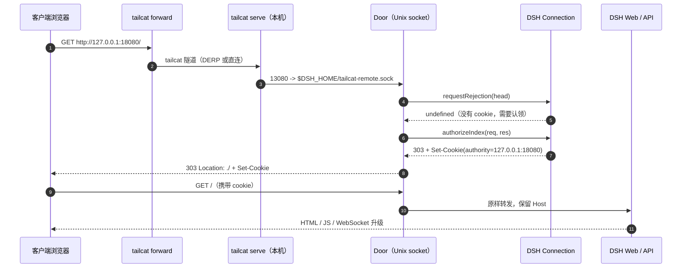

# 技术说明

这份文档面向维护者，解释远程访问为什么这样拆、请求如何穿过 door、状态放在哪里、失败时会发生什么。用户向的用法见 [README](../README.md)，安全边界见 [SECURITY](./SECURITY.md)，面板与 Host 的 JSON 契约见 [CONTRACT](./CONTRACT.md)。

## 目标与边界

需求只有三件事：

1. 让本机 Harness 的 Web GUI 可以从另一个网络访问；
2. 不开放公网端口，不改动入站防火墙；
3. 用 tailcat 当唯一的传输层，浏览器最终访问的是客户端自己的 `127.0.0.1`。

插件只做服务端：一个 Host 插件、一个设置页、一个配对页。客户端仍然使用 tailcat 自己的 `forward` 命令，本插件不包含客户端程序。

## 为什么是这三个部件

```
Host 插件
├── Door               Unix socket 上的本地 HTTP 门卫
├── TailcatSupervisor  tailcat serve 进程的生命周期
├── TailcatInstaller   检测系统 tailcat，按需安装受管版本
└── RemoteAccess       把三者与设备列表、配置、状态组合起来
```

- **Door** 是唯一能被 tailcat 访问的本地端点。默认是 `$DSH_HOME/tailcat-remote.sock`，权限 0600；`tailcat serve` 把虚拟端口 13080 映射到它。它不做自己的鉴权，而是把请求交给 DSH 的 `connection` 服务判断。这样远程访问与本地访问共用同一套 cookie、Host/Origin 校验和 owner 语义。
- **TailcatSupervisor** 只负责一个子进程：确保可执行文件与保存密钥存在，拼出 argv，解析 stdout 地址与 stderr 访问日志，做崩溃重启和地址轮换。
- **TailcatInstaller** 负责“用户到底装没装 tailcat”。它只做检测和显式安装：检测不会写文件；安装只在面板点击后发生。Linux/Windows 下载官方 release 资产并校验 SHA-256；macOS 先更新 Homebrew 再安装/升级 formula；系统里已有的 tailcat 永远优先被识别，不会被下载覆盖。Unix-socket door 和 `--log` 依赖 tailcat 0.8.0，因此低于该版本会被标为不兼容并提示升级。
- **RemoteAccess** 是门面。它串行化所有变更操作，向面板提供一份快照，避免“页面连续点两次启动”这类竞态。

Linux/macOS 默认不把 13080 开在 TCP 上。TCP `127.0.0.1` 仍对同机所有进程可见，Unix socket 的 0600 权限更小；tailcat 能在同机直接连 socket，不需要 TCP。Windows 上 tailcat 没有 Unix-socket 目标支持，因此默认改用回环 TCP；两端都只绑定 `127.0.0.1`。

## 两个 profile：web 与 desktop

同一份插件跑在两类 Host 上，差别只在 Host 怎么启动，不在传输层：

| | `dsh web`（web profile） | 桌面应用（desktop profile） |
| --- | --- | --- |
| profile 目录 | `$DSH_HOME/profiles/web` | `$DSH_HOME/profiles/desktop` |
| bundle | `dsh-base` + `dsh-web-app` | 同左（桌面应用自己初始化） |
| 启动方式 | `dsh web` | `runProfile({ profile: 'desktop', args: ['--no-open', '--host', '127.0.0.1', '--port', '0'] })` |
| Web 监听端口 | 默认 3080 | **系统分配的随机端口** |
| 谁来打开页面 | 本机浏览器 | Electron 窗口；远程浏览器则走 door |

**端口不是插件的事。** door 的转发目标来自 `ctx.webServer.port`，每次请求现取现用（`Door#target()`），启动时只等“端口出现”（`waitForWebPort()`，20 秒上限）。桌面 Host 用 `--port 0` 由系统分配端口，因此重启桌面应用后端口会变，而 door 不需要重启或改配置：下一个请求自然指向新端口。tailcat 侧永远只看到 door 的固定虚拟端口 13080，随机端口被完全藏在 Host 内部。

**运行环境只影响文案。** `src/surface.js` 读一次 `ctx.get('profileContext')?.name`，把它作为 `surface.profile` 放进快照。面板据此显示桌面版徽标、托盘说明和诊断行；door、白名单、cookie 铸造、tailcat argv 都与这个值无关。`profileContext` 不存在时（单测、手搭的 Cordis 树）该字段是 `null`，插件照常工作。

**桌面专属行与本插件无关。** `profileContext.name === 'desktop'` 会打开上游的 desktop 专属行（产品遥测、Browser 侧边栏、账号的 `desktopPlatform`）。它们只是同一棵 Loader 树里的兄弟行；本插件不注入其中任何一个，也不假设它们存在。反过来，客户端插件的 platform 只区分 `web` 与终端之类，桌面版与 web 共用 `web`，所以 `dsh.client.platform: "web"` 在两边都会加载。

**远程浏览器拿到的是普通 Web 页面。** 桌面窗口加载的是打包的 `dsh-app://` 文档，带 Electron 的 `dshDesktopBoot` 注入；远程浏览器请求的是 Host 自己 serve 的 `index.html`，走正常的 `__DSH_BOOT__` 注入路径。两条路径共用同一套客户端插件图和同一套 DSH 登录，所以远程访问不需要第二套前端。

**桌面应用没有为远程访问增加任何东西。** Host 仍然只监听回环地址；door 在 Windows 上仍然是 `127.0.0.1:13080` 的 TCP，在 macOS/Linux 上仍然是 0600 的 Unix socket。差别只在进程生命周期：关闭桌面窗口默认不退出应用，隧道会继续运行；从托盘退出才结束 Host。

## 一次远程请求的路径



关键点：

- **只在 `GET /` 且没有 `?token=` 时尝试认领**。这是 DSH 原本的登录入口；其它路径直接原样转发。`?token=` 必须继续走 DSH 本身，避免插件截获一次性 token。
- **cookie 的 authority 是客户端看到的 `127.0.0.1:18080`**，不是 Host 进程的 `127.0.0.1:3080`。DSH 的 cookie 名由 authority 派生；door 必须让 DSH 在“远程视角”下发 cookie，因此它能重放 `authorizeIndex` 的 303 和 `Set-Cookie`，而不是自己造 cookie。
- **原始字节转发**：door 解析完 HTTP 头后，把已读字节与后续字节一起 `pipe` 到上游，Host 头保持客户端视角。WebSocket 的 `Upgrade` 也是同一条路。不经过 Node 的 HTTP server，避免 `Host` 被重写、`Upgrade` 被吞掉。
- **不把 token 放进浏览器地址**。token 只在 Host 内部用于认领；远程浏览器看到的是 303 到 `./` 和 HttpOnly cookie。

## 生命周期

1. Host 插件激活，`RemoteAccess.start()` 先启动 door，再按 `autoStart` 启动 tailcat。
2. Door 在 Linux/macOS 监听 Unix socket，在 Windows 监听 `127.0.0.1:<port>`。Unix socket 路径已存在且可连接时，说明另一个实例还在用，door 报错；若是上次崩溃留下的死文件，door 在确认不可连接后删除并重建。
3. 可执行文件解析：显式 `binaryPath` 优先；默认值时先看受管目录 `$DSH_HOME/tailcat-remote/bin/tailcat`，再看 `subprocess.resolveExecutable` 解析的 PATH 和常见包管理器位置。失败会进入 `error` 状态，并在面板显示安装提示。
4. 保存密钥：`stable` 模式检查 `<user config>/tailcat/keys/<keyName>.private.json`，不存在就运行一次 `tailcat genkey --fixed-region`。`ephemeral` 模式传 `--key=new`，每次启动换地址。
5. 启动：socket 模式为 `tailcat --json --key=… serve --log [--allow=…] 13080:<socket>`；TCP 模式为 `… serve --log [--allow=…] <port>:127.0.0.1:<port>`。
6. 上线：stdout 的 `{"listenAddr":"tc…"}` 或 stderr 的 `Server listening …` 任一线索都会把状态置为 `online`；面板开始显示地址、二维码和 forwarded 命令。
7. 退出：意外退出且 `restartEnabled` 时按指数退避重启，连续失败达到 `maxRestartAttempts` 后停在 `error`；主动停止不重启。
8. 安装：面板点“一键安装 tailcat”后，`RemoteAccess.installTailcat()` 串行排队，先停掉当前隧道（如果存在），下载/校验/解压/探测，原子替换受管可执行文件，再按原来的 `desired` 状态恢复隧道。安装失败会恢复旧进程。
9. 停用插件时先停 tailcat，再关 door 并删除 socket 文件。

`RemoteAccess` 用一个 promise 队列串行化 `start/stop/restart/rotate/saveDevices/install`，所以页面的重复点击不会产生两个 tailcat 进程或两个并发下载。读取快照不走队列。

### 受管安装的优先级

1. 配置了非默认 `binaryPath`：完全按配置解析，一键安装会拒绝执行，避免“装了但没用上”。
2. 默认 `binaryPath` 且受管目录里有可执行文件：使用受管版本。
3. 否则使用 PATH 或常见安装位置（例如 macOS 的 Homebrew 前缀、Linux 的 `/usr/local/bin`）里的系统 tailcat；若探测到版本低于 0.8.0，则拒绝启动并提示升级或安装受管副本。

因此，用户之前自己安装的 tailcat 会被直接使用；只有用户在面板点击安装后，才产生受管副本。

## 状态与文件

| 位置 | 内容 | 谁写 |
| --- | --- | --- |
| `$DSH_HOME/tailcat-remote.sock` | door 的 Unix socket，模式 0600（Windows 使用回环 TCP） | Door |
| `$DSH_HOME/tailcat-remote/devices.json` | 设备公钥白名单，模式 0600，原子替换 | RemoteAccess |
| `$DSH_HOME/tailcat-remote/bin/tailcat[.exe]` | 受管可执行文件，模式 0755，原子替换 | TailcatInstaller |
| `$DSH_HOME/tailcat-remote/bin/tailcat.json` | 受管版本、来源、校验值、安装时间，模式 0600 | TailcatInstaller |
| `<user config>/tailcat/keys/<keyName>.private.json` | tailcat 保存的服务器密钥；路径按 Go `os.UserConfigDir`：Linux XDG/.config、macOS `Application Support`、Windows `%AppData%` | tailcat 自己 |
| `<user config>/tailcat/keys/<client>.private.json` | 客户端身份密钥（在客户端机器） | tailcat 自己 |

白名单是运行时状态，不是 Config。这样页面保存设备时不必改 profile patch，也不会触发插件重载；代价是它需要自己负责文件权限与损坏恢复。

## 配置项

所有字段都有默认值，通常不需要改。需要改时在 bundle row 的 `config` 里写。

| 字段 | 默认 | 说明 |
| --- | --- | --- |
| `binaryPath` | `tailcat` | PATH 名或绝对路径。默认值允许受管安装；显式路径优先，且会禁用在页面里覆盖它。 |
| `port` | `13080` | tailcat 隧道内的虚拟端口，不是本机监听端口。 |
| `listen` | Linux/macOS 为 `socket`，Windows 为 `tcp` | `socket` 使用 0600 Unix socket；`tcp` 绑定 `127.0.0.1:<port>`，并以 `<port>:127.0.0.1:<port>` 显式映射，避免 localhost 解析到 IPv6。tailcat 在 Windows 不支持 Unix socket 目标，所以 Windows 默认走回环 TCP。 |
| `socketPath` | 空 | 空表示 `$DSH_HOME/tailcat-remote.sock`。 |
| `keyName` | `dsh-tailcat` | 保存密钥名；带 `/` 时按路径处理。 |
| `addressMode` | `stable` | `stable` 重启不变；`ephemeral` 每次启动换地址。 |
| `derpMapUrl` | 空 | 自定义 DERP map；默认用 tailcat 的。 |
| `autoStart` | `true` | Host 激活时是否自动起隧道。 |
| `logAccess` | `true` | 传 `--log`，面板显示最近连接与拒绝。 |
| `restartEnabled` | `true` | 意外退出后是否自动重启。 |
| `maxRestartAttempts` | `10` | 连续重启上限。 |
| `restartBaseDelayMs` | `500` | 首次退避；之后翻倍。 |
| `restartMaxDelayMs` | `30000` | 单次退避上限。 |
| `sidebarEntry` | `true` | 是否在侧边栏的面板列表里保留快捷入口。设置里的页面始终存在，关掉只是去掉那行快捷方式；改完刷新页面生效。 |

`addressMode: ephemeral` 与 `autoStart` 同时开启时，每次 Host 重启地址都会变化；想用二维码长期配对就用 `stable`，需要换地址时在面板点“更换地址”。

## 设置页

页面本体是 `settings.section` 里的一个 section：id `tailcat-remote`，`order: 30`（排在 Agent 预设之后），`locale: 'tailcat-remote'` 拿到注入的 `t`；导航图标是同 id 的 `settings.section.icon`。这一份注册是无条件的——设置里永远能进。

侧边栏的面板列表另有一行快捷入口，由 `sidebarEntry` 决定（默认开）：开时同时注册 `sidebar.panellist` 的一行（同 id、同图标、`order: 30`）和它要选中的 `main` 页面（`key: 'tailcat-remote'`，`locale: tailcat-remote`）。两处是同一个 `RemoteSection`；`main` 的那一份套在 `.tcr-page` 里，由它负责整页高度和滚动，而设置里的那一份什么都不接管。这个开关是 Host 配置，客户端在 apply 时 `GET /api/tailcat-remote` 读一次 `config.sidebarEntry`，读不到就按默认开处理——一次请求失败不该让快捷入口消失。开关在插件配置表单里改，改完刷新页面生效。

设置面板的内容列拥有滚动和水平内边距，所以页面自己不设高度、不设 `overflow`，只描述这一列里的内容。面板宽 800，内容列约 560px，因此诊断网格是单列，**状态与诊断**和**最近连接**默认折叠，状态与配对两块保持在第一屏。侧边栏那一份跑在 `main` 里，网格在宽屏变两列。

页面只做显示与动作，不持有业务状态：

- 每 2.5 秒 `GET /api/tailcat-remote`，页面隐藏时暂停；
- 动作 `POST` 同一路径，成功后用响应里的快照立即刷新；
- 二维码由 Host 生成矩阵，客户端只把矩阵转成一条 SVG path，避免把 56KB 的 QR 生成器再打包进客户端；
- 地址默认显示为 `****`，点“显示地址”才展开；页面不渲染客户端命令与使用步骤，只保留地址、二维码和本地 URL；本地 URL 也有复制按钮，复制失败时回退到隐藏 textarea + `execCommand`；
- “更换地址”是两步确认，并明确提示：旧地址立即失效，但已签发的 DSH 浏览器 cookie 不会因此撤销；
- 安装卡片显示系统检测结果、平台安装方式、下载进度、错误和手动安装链接。

## 老 WebView 兼容

DSH 的 Web 客户端按现代 JS 引擎构建，直接调用 `AbortSignal.any`、`Promise.withResolvers`、`URL.canParse`、`Array.prototype.toSorted` 而不兜底（PDF 预览的 pdf.js 块还要 `Promise.try` 和 `URL.parse`）。HarmonyOS 与旧 Android WebView 没有这些 API，页面只会半坏：连接一直停在 “Reconnecting”，设置里的 Models 是空白，带链接或图片的消息会让 shell 的渲染器抛错，而只用一次性请求的 tab 和面板看起来正常。

远程访问本身就是这个页面到达手机的那条路，所以 `client.js` 在注册工厂之前先把这六个 API 补上：

- 只在缺失时定义，已有的原生实现原样保留；ES5 语法、单个补丁失败只记录不抛。清单不是版本表：每一条都在已发布的客户端 bundle 里有调用点，DSH 用到新 API 时同时加清单并递增 `REVISION`。
- `dsh.client.immediately` 把它放进 stage-one prefetch，脚本在其它插件 apply 之前执行。即使执行晚了也不致命：连接会退避重试，下一个 generation 就会连上。
- 结果写在 `window.__cuplivoHarnessCompat`：`revision`（页面已执行过旧副本时，新 revision 会重新跑一遍安装）、`installed` / `present` / `failed` / `missing` / `userAgent`。`missing` 只回答“这份清单还缺谁”，不代表 DSH 用到的 API 一定齐了。

## 失败模式

| 现象 | 原因 | 插件行为 |
| --- | --- | --- |
| `tailcat-not-found` | PATH/配置里没有 tailcat | 状态 `error`，面板显示安装卡片；door 仍可用 |
| `tailcat-platform-unsupported` | 当前 OS/架构没有自动安装目标 | 面板显示手动安装链接；不影响手动 `binaryPath` |
| `tailcat-brew-missing` | macOS 没有 Homebrew | 提示安装 Homebrew 或手动配置 |
| `tailcat-checksum-missing` / `tailcat-checksum-mismatch` | 官方校验清单缺项或下载被篡改 | 拒绝安装，保留旧版本 |
| `tailcat-download-failed` / `tailcat-extract-unavailable` | 网络失败、没有 tar/解压能力 | 安装失败，页面给出底层错误 |
| `door-socket-missing` | door 未起或 socket 被删 | supervisor 拒绝启动，提示先恢复 door |
| `door-tls-unsupported` | Web listener 是 HTTPS | door 拒绝启动，要求在前面终止 TLS 或改用 HTTP 本地监听 |
| `EADDRINUSE`/socket 被占用 | 另一个 DSH 实例或残留进程 | door 报错；不会杀掉不认识的进程 |
| 地址一直不出现 | DERP 不可达、代理阻断 | 状态停在 `starting`；保留 stderr 尾部供诊断 |
| `[peer] refused … not-in-allow` | 客户端不在白名单 | 面板计数并显示拒绝记录 |
| 地址更换后页面断开 | 页面本身正走旧隧道 | 属预期；在本机页面操作，或重新配对 |
| 页面半坏（Reconnecting、Models 空白、带链接的消息抛错） | WebView 引擎缺少 DSH 客户端需要的 API | 启动时由客户端补丁补齐；仍异常时读 `window.__cuplivoHarnessCompat`，`missing` 只说明清单内的缺口 |

## 测试

`node --test` 覆盖纯逻辑：地址/日志解析、argv 构造、QR 矩阵、白名单持久化、配置默认值与 manifest，以及安装器的平台矩阵、校验清单解析、系统 tailcat 检测和版本下限。客户端 bundle 也在删掉原生 API 的上下文里加载过一遍：断言补丁先于工厂注册就位、已有实现不被覆盖，并覆盖 `AbortSignal.any` 的语义。

网络行为（真实下载、解压、运行 tailcat、serve 目标）由 `.github/workflows/installer-smoke.yml` 在 Linux、Windows、macOS runner 上执行；它使用真实 GitHub release，并在测试后清理临时目录。普通 CI 在三种 OS 上做 `npm ci`、语法检查、单元测试和 `npm pack --dry-run`，避免每次提交都依赖外部网络；cookie 认领、WebSocket 等完整浏览器路径不在 CI 的 smoke 范围内。

桌面版由 `.github/workflows/desktop-profile.yml` 覆盖。公开 CLI 拒绝 `--profile desktop`，runner 上也没有 Electron，所以工作流直接调用桌面宿主使用的公开入口 `@deepseek-ai/dsh/profile-boot` 的 `runProfile`，参数与 Electron 完全一致（回环地址、`--port 0`、`--no-open`）。profile 用公开命令准备：先用 `--from-default-profile web` 写出与桌面应用相同的两个 bundle，再用 `dsh plugin add` 安装本包，最后把目录改名成 `desktop`。断言全部走网络侧：面板 API 报出 `surface.profile === "desktop"`、`web.port` 等于实际监听端口、`door.target` 指向该端口；door 对 `Host: 127.0.0.1:18080` 铸造 cookie、对陌生 Host 拒绝且不发 cookie；带 cookie 取回的 index 里 `__DSH_BOOT__` 含有本插件条目，该条目的客户端 bundle 可以经 door 取到。Windows 与 macOS 跑关闭隧道的确定性路径，ubuntu 额外挂上 CI 的 tailcat stub、强制 `listen: tcp` 并用 Chromium 从 door（而不是 token URL）打开面板，断言桌面版徽标、托盘说明、遮罩地址与二维码按钮，并产出 `docs/screenshots/04-desktop.png`。

没有构建步骤：包直接发布源码，客户端文件是原生 `React.createElement`，不需要打包。
